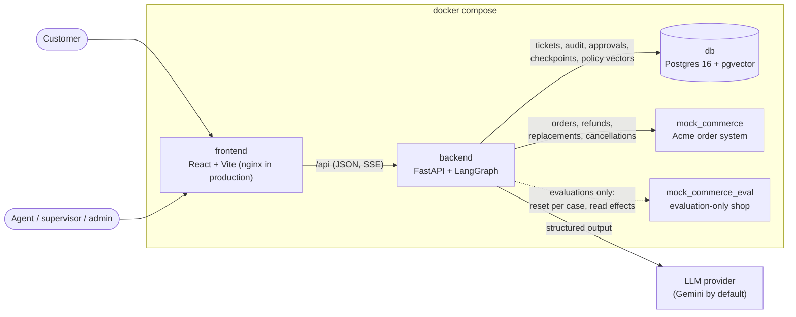
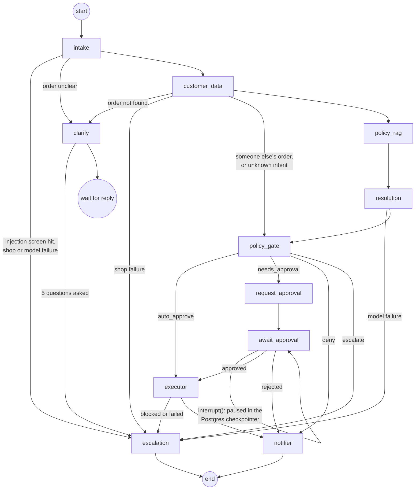
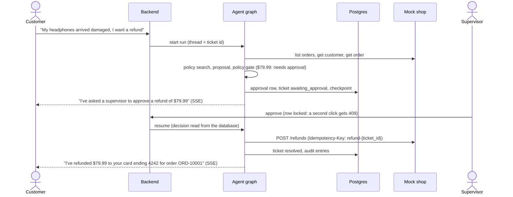
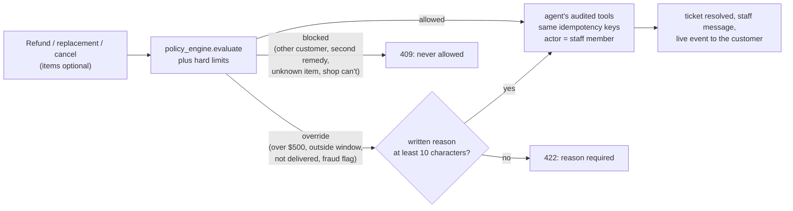
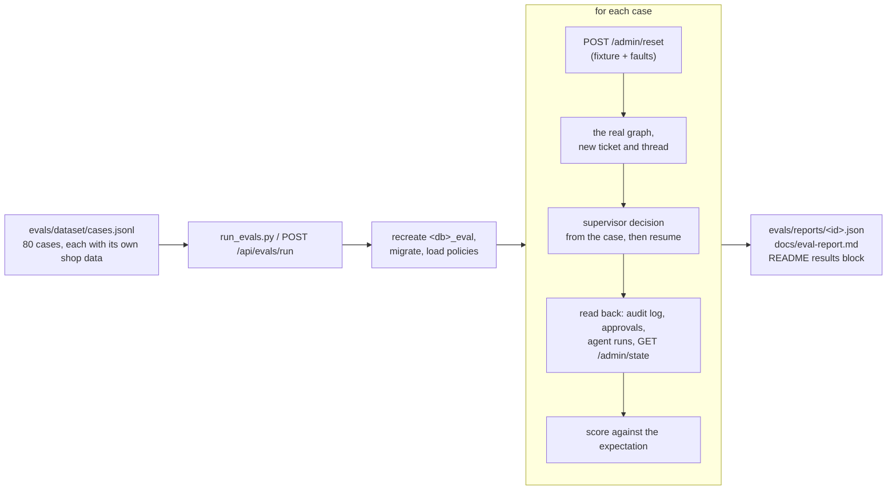

# Architecture

SupportPilot resolves customer support requests end to end. A LangGraph agent reads the request,
looks up the customer's order through a commerce API, retrieves the governing policy, and
proposes one action. Deterministic Python decides whether that action runs, waits for a
supervisor, or goes to a human. Every step is written to an append-only audit log.

## Services

- The **frontend** never talks to the shop or the model. It holds the 15-minute access token in
  memory and renews it with an HttpOnly refresh cookie.
- The **backend** is one process: API, agent runs (background tasks), live events (SSE), and
  in-memory rate limits. See the README's limitations for what that implies.
- The **mock shop** keeps its data in memory and supports idempotency keys and fault injection.
  The evaluation shop is a second instance with admin endpoints; the demo shop has them off.

## Agent graph

What each step may and may not do:

| Step | Does | Never |
| --- | --- | --- |
| intake | Screens for prompt injection, lists the customer's own orders, classifies the intent, matches the order | Accepts an order the model picked that is not in the customer's list |
| customer_data | Fetches the customer and the order | Decides ownership (the policy gate does, and audits it) |
| policy_rag | Searches the policy documents that govern the intent | Sends the model sections from unrelated documents |
| resolution | Asks the model for one proposed action, SKUs, a reason, and citations | Lets the model set an amount (the schema has no amount field) |
| policy_gate | Applies the business rules in `policy_engine.py` and audits the decision | Calls the model |
| executor | Re-checks the decision and any approval, then calls the tool with a per-ticket idempotency key | Acts without `auto_approve` or an approved approval row |

Routing reads facts from the state; no route asks the model.

## Approval flow

## When the agent hands over

Escalated tickets (and open ones the agent is not running) get a "Handle this ticket" panel in
the console. A staff member can reply, act, or close:

The ticket row is locked with `FOR NO KEY UPDATE` while a person acts, so two simultaneous
actions cannot both run. `FOR UPDATE` would also block the audit inserts that reference the row
from other connections.

## Evaluation harness

- Effects (refunds, replacements, cancellations) are read from the evaluation shop itself, so
  an action counts even if the agent's own record of it were wrong.
- With `--llm mock`, a keyword stand-in replaces the model. CI uses it on the first ten cases to
  check the wiring without calling a paid model; it says nothing about model quality.
- The live model runs at temperature 0 unless it accepts only its own default (reasoning
  models); the report records which. Per-minute rate limits are waited out; a daily quota or an
  account without credit stops the run, and the report is marked incomplete.

## Data model

| Table | Holds |
| --- | --- |
| users | Email, bcrypt hash, role, and for customers the commerce customer id |
| refresh_tokens | Hashed refresh tokens, rotation chain, revocation |
| tickets | Public id (TCK-1000), customer, order, category, status, priority, summary, `customer_replied` |
| messages | The conversation (customer, agent, supervisor, system) |
| approvals | The proposed action, status, decider, note |
| audit_logs | Every step, tool call (including rejected ones), policy decision, and human decision. Append-only: a trigger rejects UPDATE and DELETE |
| agent_runs | Tokens, cost, latency, and status of each run |
| policy_chunks | Policy sections with 384-dimension embeddings |
| checkpoint_* | LangGraph's checkpointer tables (plain JSON state) |
